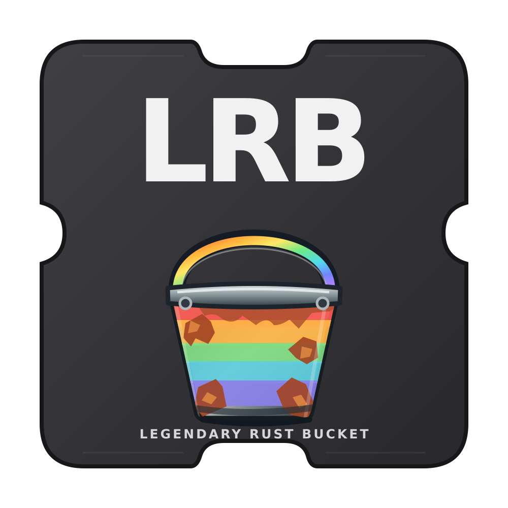

<p align="center"></p>
<h1 align="center">LRB — LegendaryRustBucket</h1>
<p align="center">An experimental, fully <strong>Rust-native</strong> Epic Games launcher foundation focused on Rocket League for Windows and Linux.</p>

> **Development status — not a production-ready Rocket League replacement.** All active launcher source code is Rust. There is **no Python code, Python interpreter, or Legendary executable dependency**. Epic sign-in and native HTTP requests are implemented, but game installation, update/manifest processing, and full Rocket League online launch compatibility are **not yet finished or validated**. No claims of increased FPS, reduced ping, or improved launch time have been measured.

## Rust-only architecture

This project is a from-scratch Rust implementation inspired by [Legendary](https://github.com/legendary-gl/legendary), not a Python wrapper. It preserves the upstream GPL-3.0-or-later license and attribution. You do not need to install Python or `legendary-gl` to build or run LRB.

The new Rust code covers CLI argument handling, configuration and secure local session storage, Epic OAuth authorization-code/refresh-token exchange over HTTPS, Epic library requests, local game registration, installation executable checks, and direct process spawning with Wine selection on Linux. It does not patch game files, spoof anti-cheat, or rewrite network traffic.

## Build

Install the [Rust toolchain](https://rustup.rs) on **Windows or Linux** and run:

```bash
cargo build --release
cargo test
cargo run -- help
cargo run -- doctor
```

The resulting binary is `target/release/lrb` (Linux) or `target/release/lrb.exe` (Windows). Dependencies are Rust crates from crates.io, not the Python Legendary launcher.

## Epic sign-in and library (experimental)

```bash
lrb auth
# Open the official Epic URL printed by LRB and retrieve the authorization code.
lrb auth --code YOUR_AUTHORIZATION_CODE
lrb auth status
lrb library
```

The browser sign-in uses Epic's normal webpage. Enter the authorization code locally; **never share it, your refresh token, or your saved session file**. Tokens are stored in your user configuration directory (`LRB_HOME` overrides the directory), with owner-only permissions on Unix. To remove the saved token, run `lrb auth logout`. Epic may update its OAuth flow or require additional account actions. Live authentication has **not** been tested with a real account in this milestone.

## Register an existing Rocket League installation (experimental)

LRB does not download or update the game yet. For an **existing, legitimately installed game**, register the app with its actual Epic `appName` and namespace (from your own authorized Epic account/metadata), and its installed executable:

```bash
lrb register --app YOUR_EPIC_APP_NAME --title "Rocket League" \
  --path "/path/to/RocketLeague" --exe "Binaries/Win64/RocketLeague.exe" \
  --namespace YOUR_EPIC_NAMESPACE

lrb list
lrb verify --app "Rocket League"
lrb launch --app "Rocket League" --dry-run
lrb launch --app "Rocket League"
```

On Windows, use a Windows directory path for `--path`. On Linux, the native launcher will attempt to spawn Windows executables via the `wine` binary in `PATH`; set `LRB_WINE` or use `--wine /path/to/wine` to choose the runtime. File paths and executable names vary by installation. `verify` only checks the executable exists; it **is not** a content-integrity check.

The launch command requests an Epic exchange code and supplies standard Epic launch parameters without touching the game or anti-cheat. **Whether Rocket League successfully connects online through this flow remains untested**, particularly in Wine/Proton environments.

## Current capabilities

| Subsystem | Status |
| --- | --- |
| New `lrb` binary written entirely in Rust | Implemented; CI build/tests run on Linux and Windows |
| Python source and Python workflows | Removed from active repository |
| Epic account authorization and token refresh (Rust HTTPS) | Implemented; account integration requires live testing |
| Epic library API query (Rust HTTPS) | Implemented; live response requires validation |
| Local game registration, executable safety checks, diagnostics | Implemented; unit tested |
| Local game process spawning with Epic token and Wine option | Implemented; real Rocket League play not validated |
| Game manifest download/parsing | Not implemented |
| Parallel game installer, patching, full verification | Not implemented |
| FPS/frame-time and ping optimizations | Not benchmarked; no performance claim |

## Benchmark policy and Rocket League anti-cheat

The goal is an efficient, cross-platform native launcher with reliable installation and sensible opt-in launch profiles, not misleading claims that a launcher automatically improves Rocket League's FPS or network routing. We will measure launcher cold startup, memory/CPU usage, install throughput, and game frame-time behavior in controlled comparisons before claiming improvements. Network diagnostics can measure latency/jitter but cannot guarantee lower in-game ping. Easy Anti-Cheat must remain intact.

## Project origin

Forked from [legendary-gl/legendary](https://github.com/legendary-gl/legendary), whose original project is licensed under the GPL-3.0-or-later. New LRB code is also GPL-3.0-or-later. LRB is not endorsed by Epic Games, Psyonix, or the Legendary team.
